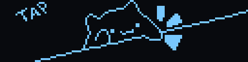
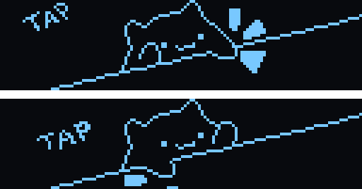
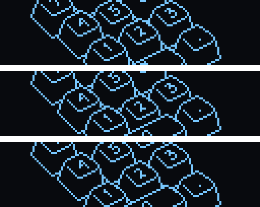
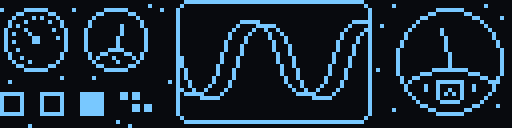
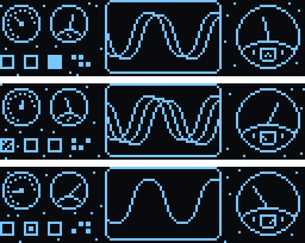
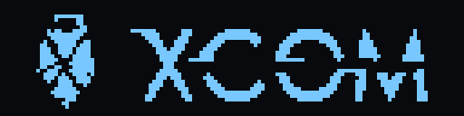
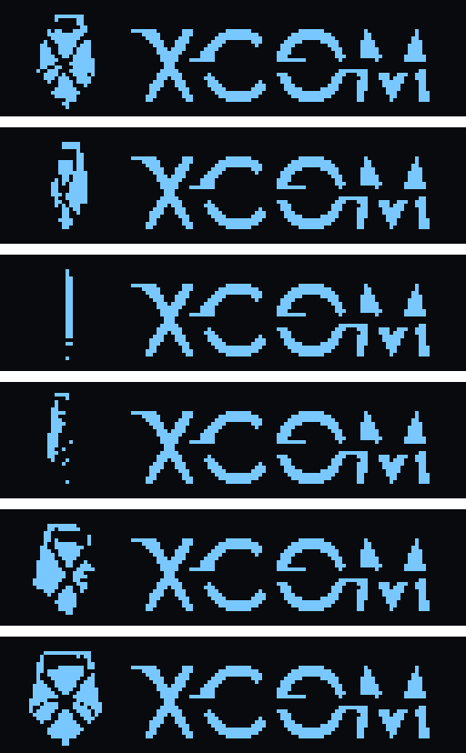

# QMKanim

A QMK keymap for a 4×12 ortho keyboard with a 128×32 OLED that plays a different pixel-art animation for each layer. The animation advances every 250 ms, and the screen turns off after `OLED_TIMEOUT` with no keypresses. Any key wakes it.

All images below were rendered straight from the bitmap arrays in `keymap.c`, at 4× scale, so they show what the OLED displays.

## Animations

### Base layer (0): Tap cat

A cat tapping away at the keyboard. Two frames, alternating.

Frames

### Symbol layer (1): Cursing

Speech bubbles full of `#%~`, `@?` and `$*`. Three frames, played back and forth (01 → 02 → 03 → 02).

Frames

### Fn / Numpad layer (2): Number keys

A numpad cluster with keys being pressed. Three frames, looping.

Frames

### System layer (3): Control panel

Gauges, status lights, an oscilloscope waveform and a radar dial. Three frames, played back and forth.

Frames

### X-COM layer (4): Spinning logo

The X-COM wordmark with a spinning emblem. Six frames, looping. Layer 5 (X-COM numbers) shows the text "X-COM / NUMBERS" instead of an animation.

Frames

## Layers

| # | Name | How to get there | What's on it |
|---|------|------------------|--------------|
| 0 | `BASE` | default | QWERTY, with Ctrl/Down and Alt/Up as mod-taps |
| 1 | `SYMBOL` | `TT(1)` (Caps Lock position) | Symbols, brackets, browser back/forward/refresh |
| 2 | `FNUM` | `TT(2)` (left thumb) | F1–F15 and a numpad on the right half |
| 3 | `SYSTEM` | `TT(3)` (right thumb) | Navigation, media keys, volume, sleep, Task Manager |
| 4 | `XCOM` | `TO(4)` from `SYSTEM` (Q position) | Left half for gaming; any right-half key returns to `BASE` |
| 5 | `XNUM` | `MO(5)` from `XCOM` | Number row 1–0 on the left half |

## How it works

- Each frame is a raw SSD1306 buffer: one byte per 8-pixel vertical column, 128 columns per page. Frames are drawn with `oled_write_raw_P`.
- `ANIM_SIZE` (520 bytes) is used for the 128×32 frames. `XANIM_SIZE` (650 bytes) is used for the symbol and X-COM frames, which were exported at 128×34. QMK clips the write to the 512-byte display buffer, so the bottom two rows of those frames are never shown.
- The frames in each array are listed in reverse order. `abs((FRAMES - 1) - current_tap_frame)` flips the order at playback. The symbol and system layers use `% (TAP_FRAMES + 1)`, which makes them play back and forth.
- `process_record_user` resets the sleep timer on every keypress.

## Building

Copy `keymap.c` into a keymap folder for your keyboard and enable the OLED in `rules.mk`. The file checks `#ifdef OLED_DRIVER_ENABLE`. That was QMK's old flag; current QMK uses `OLED_ENABLE = yes` and `OLED_ENABLE`. On a current QMK version, update the `#ifdef` to match, or the animations will be compiled out.
